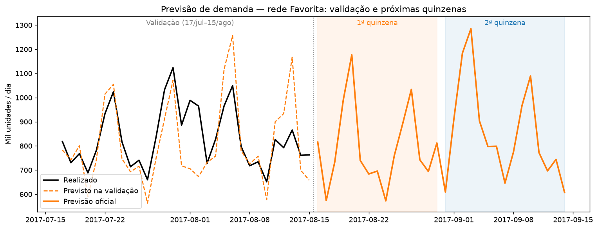
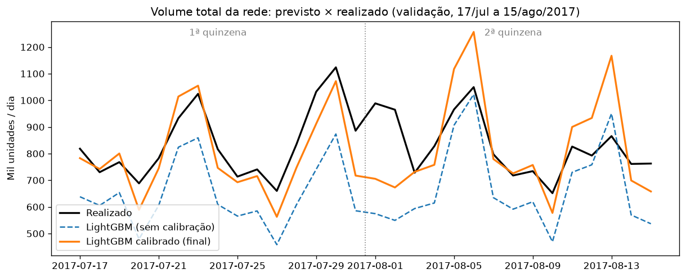
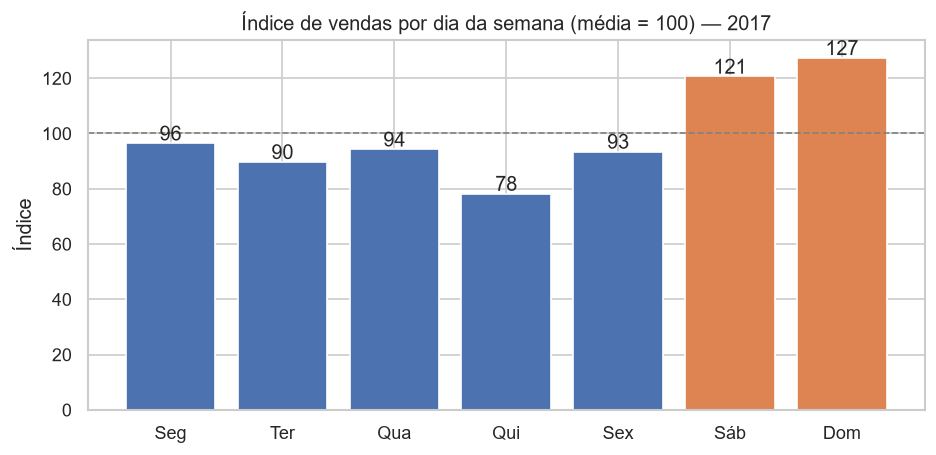
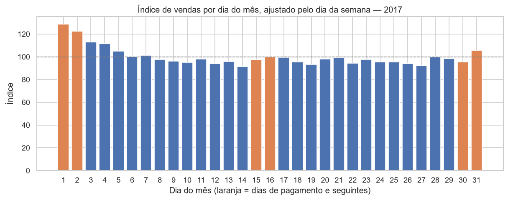

# 🛒 Retail Demand Forecasting — Corporación Favorita

[](https://favorita-previsao.streamlit.app)


🇧🇷 [Versão em português](README.md)

Daily sales forecasting for **54 stores × ~4,000 products** of an Ecuadorian supermarket chain over
the **next two fortnights**, turning 23.8 million historical records into **purchasing, inventory,
distribution and waste-reduction decisions**.

### 👉 [Open the interactive dashboard](https://favorita-previsao.streamlit.app)

> The dashboard interface is in Portuguese.



---

## ⏱️ 30-second summary

| Indicator | Result |
|---|---|
| 🎯 **Goal** | Forecast how many units of each product each store will sell over the **next two fortnights** |
| 🤖 **Solution** | 30 LightGBM models — one per day ahead — plus a final volume calibration |
| 📉 **Gain over simple methods** | **9% lower error** than repeating the average sales of recent weeks |
| ⚖️ **Forecast correction** | From **~21% below** actual sales (systematic stockout risk) to **~3%** |
| 🎯 **Accuracy for purchasing** | **~6%** error when planning a product family's purchase for the fortnight |
| 📦 **Forecast Aug 16–30, 2017** | **11.9 million** units |
| 📦 **Forecast Aug 31–Sep 14, 2017** | **12.8 million** units (+7.2%, driven by the start-of-month payday) |

---

## 💼 Business problem

A supermarket chain must decide, every cycle, **how much to buy and distribute** to each store.
Buying too little causes **stockouts** (lost sales); buying too much causes **idle inventory** and,
for perishables, **waste**. A good demand forecast reduces both risks.

## 📊 Data

Public dataset from the
[Corporación Favorita Grocery Sales Forecasting](https://www.kaggle.com/competitions/favorita-grocery-sales-forecasting)
competition (Kaggle): ~125 million daily sales by store × item (2013–2017), with promotions,
holidays, store and product metadata, and oil prices. Modeling used **all of 2017
(23.8 million records)**.

## 🔬 Approach

| Step | Notebook | What was done |
|---|---|---|
| 1. Loading | [01](notebooks/01_setup_e_carga.ipynb) | Chunked reading, compact dtypes and Parquet (4.9 GB → 0.43 GB in memory) |
| 2. Exploratory analysis | [02](notebooks/02_eda.ipynb) | Trend, seasonality, payday effect, ABC curve, stores, promotions and holidays |
| 3. Features | [03](notebooks/03_features.ipynb) | Store × item × day matrix with explicit zeros; 61 leakage-free features |
| 4. Modeling | [04](notebooks/04_modelagem.ipynb) | Baselines × 30 LightGBM models (**direct forecasting**: one model per day ahead) |
| 5. Evaluation | [05](notebooks/05_avaliacao.ipynb) | Bias calibration and error by ABC class, perishability, store and family |
| 6. Forecast | [06](notebooks/06_previsao.ipynb) | Final model retrained; forecast from Aug 16 to Sep 14, 2017 |
| 7. Executive summary | [07](notebooks/07_resumo_executivo.ipynb) | Insights, accuracy by decision level and action plan |

> Notebooks are written in Portuguese; code and function names are in English.

**Key technical decisions**
- **Direct forecasting:** one model per horizon (h = 1…30), avoiding the error accumulation of
  recursive forecasting — each fortnight is forecast independently.
- **Leakage-free temporal validation:** 8 weekly training cutoffs and a "blind" validation period
  (Jul 17–Aug 15, 2017), with automated checks.
- **Calibration:** training on a log scale underestimated volume by ~21% (Jensen's inequality);
  family-level factors, estimated outside training, corrected the bias.
- **Sanity check:** assuming "no promotions" in September distorted the forecast through a
  distribution shift — detected, diagnosed and fixed in notebook 06.

## 📈 Results

**Model × simple methods (validation, 30 days)**

| Model | NWRMSLE ↓ | Bias |
|---|---|---|
| 28-day average | 0.671 | −19.8% |
| Same-weekday average (4 weeks) | 0.703 | −13.6% |
| **LightGBM** | **0.610** (−9%) | −20.7% |
| **Calibrated LightGBM (final)** | 0.628 | **−2.6%** |

**Accuracy depends on the decision level** (error on the fortnight total)

| Level | Decision supported | Error (WAPE) |
|---|---|---|
| Store × product | shelf replenishment | 27–33% |
| Store × family | store orders | 9–12% |
| **Family across the chain** | **supplier purchasing** | **~6%** |
| Whole chain | budgeting | 0–5% |



## 💡 Key insights

1. **Weekends concentrate ~35% of sales**; Thursday is the weakest day.
2. **Payday drives the month:** days 1–5 sell 13–28% above average.
3. **Concentration:** 3 families = 67% of volume; 42.5% of items = 80%; Quito = 51%.
4. **Perishables are the most predictable**, but forecasts tend to overshoot — and surplus becomes waste.
5. **Promotions lift volume by +33%** (up to +60% in beverages), but without margin data it is not
   possible to say they pay off financially.
6. **The promotional calendar is critical information**: without it, the forecast can be off by up to 28%.
7. **Every holiday is different:** Labor Day sells +58%; Mother's Day, −19%.
8. **Competition metric ≠ business metric:** the model optimal for the official metric forecast
   21% below actual volume until calibrated.

| Weekly pattern | Payday effect |
|---|---|
|  |  |

## 🧭 Business recommendations

| Area | Recommendation |
|---|---|
| **Purchasing** | Plan by family × fortnight (~6% error); anticipate the start-of-month peak |
| **Inventory** | Service level by ABC class (A 98% · B 95% · C 90%) |
| **Perishables** | Order below forecast for prepared foods; daily replenishment for produce, poultry and dairy |
| **Commercial** | Focus promotions on beverages; share the promotional calendar 30 days ahead |
| **Logistics** | Daily deliveries to large stores (type A), consolidated deliveries to smaller ones |
| **Stores** | Reinforce staff on weekends and days 1–5; run inventory counts on Thursdays |

## 🖥️ Interactive dashboard

[**favorita-previsao.streamlit.app**](https://favorita-previsao.streamlit.app) — filters by store
type, city, store and product family; forecast for both fortnights; model accuracy (error, bias,
shortage and excess); product lookup; and CSV download of the forecast.

## 📁 Repository structure

```
favorita-forecasting/
├── app/                  # Streamlit dashboard + aggregated data (app/data)
├── notebooks/            # 01 to 07: from data loading to executive summary
├── reports/figures/      # Charts generated in the notebooks
├── src/                  # Reusable code
│   ├── data.py           #   data loading and family translations
│   ├── features.py       #   feature engineering (direct forecasting)
│   ├── models.py         #   baselines and 30 LightGBM models
│   ├── metrics.py        #   NWRMSLE, WAPE, bias, shortage × excess
│   ├── calibration.py    #   forecast volume calibration
│   ├── forecast.py       #   future forecast and promotional calendar
│   └── dashboard_data.py #   aggregated data for the dashboard
└── requirements.txt
```

## ▶️ How to reproduce

```bash
git clone https://github.com/elieserribeiro/favorita-forecasting.git
cd favorita-forecasting
python -m venv .venv
# Windows: .venv\Scripts\activate   |   Linux/Mac: source .venv/bin/activate
pip install pandas numpy pyarrow matplotlib seaborn plotly lightgbm scikit-learn statsmodels ipykernel streamlit
```

1. Download the data from the [Kaggle competition](https://www.kaggle.com/competitions/favorita-grocery-sales-forecasting/data)
   and extract the CSVs into `data/raw/`.
2. Run notebooks `01` to `07` in order (model training takes ~20–35 min each).
3. Build the dashboard data and run it locally:
   ```bash
   python -m src.dashboard_data
   streamlit run app/app.py
   ```

## ⚠️ Limitations and next steps

- **No inventory, price or margin data:** it is not possible to separate lack of demand from
  stockouts, nor to optimize the financial result of promotions.
- **Calendar events** (payday, long holiday weekends) still account for the largest errors.
- **New and slow-moving items** have high error.
- **Next steps:** prediction intervals for safety stock, richer calendar features, calibration by
  family × store type, and automated retraining.

## 🛠️ Tech stack

Python · pandas · NumPy · LightGBM · scikit-learn · Matplotlib · Seaborn · Plotly · Streamlit · Parquet

## 👤 Author

**Eliéser Ribeiro** · [GitHub](https://github.com/elieserribeiro) · [LinkedIn](https://www.linkedin.com/in/elieser-ribeiro-msc-72a12470/)