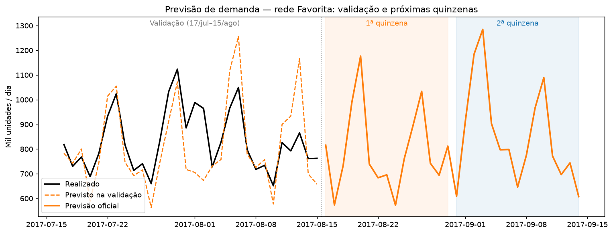
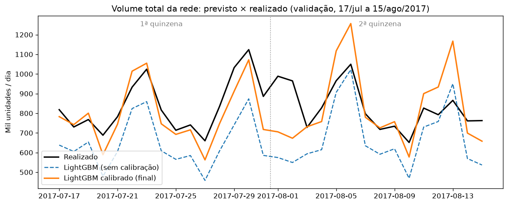
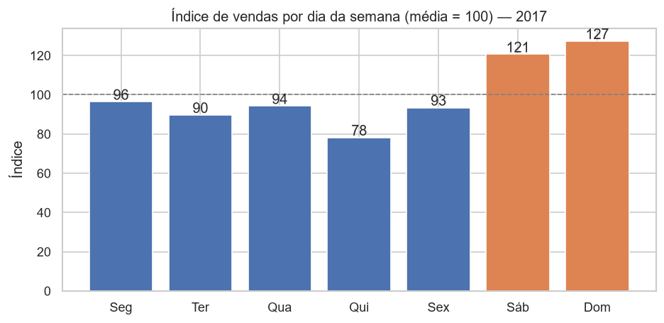
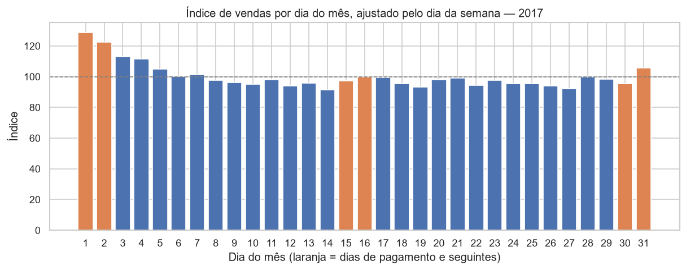

# 🛒 Previsão de Demanda no Varejo — Corporación Favorita

[](https://favorita-previsao.streamlit.app)


🇺🇸 [English version](README.en.md)

Previsão de vendas diárias de **54 lojas × ~4 mil produtos** de uma rede de supermercados do
Equador para as **duas quinzenas seguintes**, transformando 23,8 milhões de registros históricos
em **decisões de compras, estoque, distribuição e redução de perdas**.

### 👉 [Acesse o painel interativo](https://favorita-previsao.streamlit.app)



---

## ⏱️ Resumo em 30 segundos

| Indicador | Resultado |
|---|---|
| 🎯 **Objetivo** | Prever quantas unidades de cada produto cada loja vai vender nas **duas quinzenas seguintes** |
| 🤖 **Solução** | 30 modelos LightGBM — um para cada dia à frente — com ajuste final do volume previsto |
| 📉 **Ganho sobre métodos simples** | **9% menos erro** do que repetir a média de vendas das últimas semanas |
| ⚖️ **Correção da previsão** | De **~21% abaixo** do realizado (risco de ruptura sistemática) para **~3%** |
| 🎯 **Precisão para compras** | Erro de **~6%** ao planejar a compra de uma família de produtos para a quinzena |
| 📦 **Previsão 16–30/ago/2017** | **11,9 milhões** de unidades |
| 📦 **Previsão 31/ago–14/set/2017** | **12,8 milhões** de unidades (+7,2%, puxada pelo pagamento de salários) |

---

## 💼 O problema de negócio

Uma rede de supermercados precisa decidir, a cada ciclo, **quanto comprar e distribuir** para cada
loja. Comprar de menos gera **ruptura** (produto em falta, venda perdida); comprar demais gera
**estoque parado** e, nos perecíveis, **perda**. Uma boa previsão de demanda reduz os dois riscos.

## 📊 Os dados

Dataset público da competição
[Corporación Favorita Grocery Sales Forecasting](https://www.kaggle.com/competitions/favorita-grocery-sales-forecasting)
(Kaggle): ~125 milhões de vendas diárias por loja × item (2013–2017), com promoções, feriados,
cadastro de lojas e produtos e preço do petróleo. A modelagem usou **2017 completo
(23,8 milhões de registros)**.

## 🔬 Abordagem

| Etapa | Notebook | O que foi feito |
|---|---|---|
| 1. Carga | [01](notebooks/01_setup_e_carga.ipynb) | Leitura em blocos, tipos enxutos e Parquet (4,9 GB → 0,43 GB em memória) |
| 2. Análise exploratória | [02](notebooks/02_eda.ipynb) | Tendência, sazonalidade, pagamento, curva ABC, lojas, promoções e feriados |
| 3. Features | [03](notebooks/03_features.ipynb) | Matriz loja × item × dia com zeros explícitos; 61 variáveis sem vazamento de dados |
| 4. Modelagem | [04](notebooks/04_modelagem.ipynb) | Baselines × 30 LightGBM (**previsão direta**: um modelo por dia à frente) |
| 5. Avaliação | [05](notebooks/05_avaliacao.ipynb) | Calibração do viés e erro por classe ABC, perecível, loja e família |
| 6. Previsão | [06](notebooks/06_previsao.ipynb) | Modelo final retreinado e previsão de 16/ago a 14/set/2017 |
| 7. Resumo executivo | [07](notebooks/07_resumo_executivo.ipynb) | Insights, precisão por nível de decisão e plano de ação |

**Decisões técnicas importantes**
- **Previsão direta:** um modelo para cada horizonte (h = 1…30), evitando o acúmulo de erro da
  previsão recursiva — cada quinzena é prevista de forma independente.
- **Validação temporal sem vazamento:** 8 cortes semanais de treino e um período de validação
  "às cegas" (17/jul–15/ago/2017), com checagens automáticas.
- **Calibração:** o treino em escala log subestimava o volume em ~21% (desigualdade de Jensen);
  fatores por família, estimados fora do treino, corrigiram o viés.
- **Checagem de sanidade:** a hipótese "sem promoções" em setembro distorcia a previsão por
  mudança de distribuição — detectado, diagnosticado e corrigido no notebook 06.

## 📈 Resultados

**Modelo × métodos simples (validação, 30 dias)**

| Modelo | NWRMSLE ↓ | Viés |
|---|---|---|
| Média dos últimos 28 dias | 0,671 | −19,8% |
| Média do dia da semana (4 semanas) | 0,703 | −13,6% |
| **LightGBM** | **0,610** (−9%) | −20,7% |
| **LightGBM calibrado (final)** | 0,628 | **−2,6%** |

**A precisão depende do nível da decisão** (erro no total da quinzena)

| Nível | Decisão que apoia | Erro (WAPE) |
|---|---|---|
| Loja × produto | reposição da gôndola | 27–33% |
| Loja × família | pedido de cada loja | 9–12% |
| **Família na rede** | **compra do fornecedor** | **~6%** |
| Rede inteira | orçamento | 0–5% |



## 💡 Principais insights

1. **O fim de semana concentra ~35% das vendas**; quinta-feira é o dia mais fraco.
2. **O pagamento move o mês:** os dias 1–5 vendem 13–28% acima da média.
3. **Concentração:** 3 famílias = 67% do volume; 42,5% dos itens = 80%; Quito = 51%.
4. **Perecíveis são os mais previsíveis**, mas a previsão tende a sobrar — e sobra vira perda.
5. **Promoções elevam o volume em +33%** (até +60% em bebidas), mas sem dados de margem não é
   possível afirmar que compensam financeiramente.
6. **O calendário promocional é informação crítica**: sem ele, a previsão pode distorcer em até 28%.
7. **Cada feriado é único:** o Dia do Trabalho vende +58%; o Dia das Mães, −19%.
8. **Métrica de competição ≠ métrica de negócio:** o modelo ótimo para a métrica oficial previa
   21% abaixo do volume real até ser calibrado.

| Padrão semanal | Efeito do pagamento |
|---|---|
|  |  |

## 🧭 Recomendações gerenciais

| Área | Recomendação |
|---|---|
| **Compras** | Planejar por família × quinzena (erro de ~6%); antecipar o pico do início do mês |
| **Estoque** | Nível de serviço por classe ABC (A 98% · B 95% · C 90%) |
| **Perecíveis** | Pedir abaixo da previsão em comida pronta; reposição diária em hortifrúti, aves e laticínios |
| **Comercial** | Concentrar promoções em bebidas; compartilhar o calendário promocional com 30 dias de antecedência |
| **Logística** | Entregas diárias para lojas grandes (tipo A) e consolidadas para as menores |
| **Lojas** | Reforçar equipe nos fins de semana e nos dias 1–5; inventário às quintas-feiras |

## 🖥️ Painel interativo

[**favorita-previsao.streamlit.app**](https://favorita-previsao.streamlit.app) — filtros por tipo de
loja, cidade, loja e família; previsão das duas quinzenas; precisão do modelo (erro, viés, falta e
excesso); consulta por produto; e download da previsão em CSV.

## 📁 Estrutura do repositório

```
favorita-forecasting/
├── app/                  # Painel Streamlit + dados resumidos (app/data)
├── notebooks/            # 01 a 07: da carga ao resumo executivo
├── reports/figures/      # Gráficos gerados nos notebooks
├── src/                  # Código reutilizável
│   ├── data.py           #   carga dos dados e tradução das famílias
│   ├── features.py       #   engenharia de features (previsão direta)
│   ├── models.py         #   baselines e 30 modelos LightGBM
│   ├── metrics.py        #   NWRMSLE, WAPE, viés, falta × excesso
│   ├── calibration.py    #   calibração do volume previsto
│   ├── forecast.py       #   previsão futura e calendário promocional
│   └── dashboard_data.py #   dados resumidos para o painel
└── requirements.txt
```

## ▶️ Como reproduzir

```bash
git clone https://github.com/elieserribeiro/favorita-forecasting.git
cd favorita-forecasting
python -m venv .venv
# Windows: .venv\Scripts\activate   |   Linux/Mac: source .venv/bin/activate
pip install pandas numpy pyarrow matplotlib seaborn plotly lightgbm scikit-learn statsmodels ipykernel streamlit
```

1. Baixe os dados da [competição no Kaggle](https://www.kaggle.com/competitions/favorita-grocery-sales-forecasting/data)
   e extraia os CSVs em `data/raw/`.
2. Rode os notebooks de `01` a `07`, em ordem (o treino dos modelos leva ~20–35 min cada).
3. Gere os dados do painel e abra-o localmente:
   ```bash
   python -m src.dashboard_data
   streamlit run app/app.py
   ```

## ⚠️ Limitações e próximos passos

- **Sem dados de estoque, preço e margem:** não é possível separar falta de demanda de ruptura,
  nem otimizar o resultado financeiro das promoções.
- **Eventos de calendário** (pagamento, feriados prolongados) ainda concentram os maiores erros.
- **Itens novos e de baixo giro** têm erro elevado.
- **Próximos passos:** intervalos de previsão para estoque de segurança, features de calendário
  mais ricas, calibração por família × tipo de loja e retreino automatizado.

## 🛠️ Tecnologias

Python · pandas · NumPy · LightGBM · scikit-learn · Matplotlib · Seaborn · Plotly · Streamlit · Parquet

## 👤 Autor

**Eliéser Ribeiro** · [GitHub](https://github.com/elieserribeiro) · [LinkedIn](https://www.linkedin.com/in/elieser-ribeiro-msc-72a12470/)